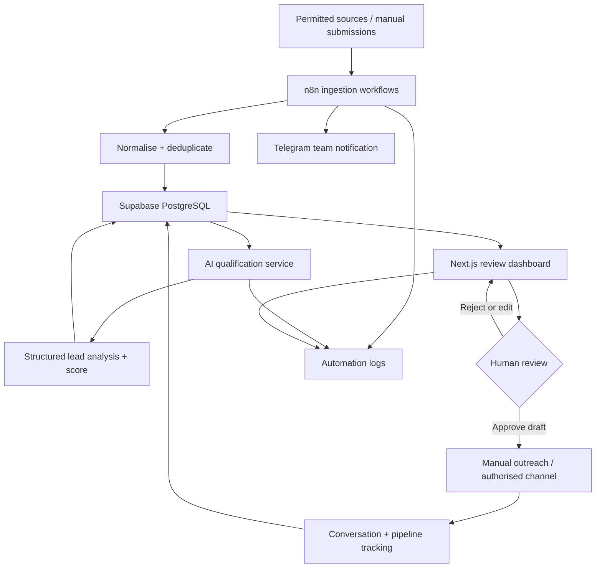

# LeadHunter AI

**AI-powered lead discovery, qualification and acquisition platform for SpiritusTec.**

LeadHunter AI is designed to discover publicly available business opportunities, understand the problem being expressed, match it to SpiritusTec's services, score its commercial relevance, prepare tailored outreach drafts, and track the journey from opportunity to client.

The first release is an **internal SpiritusTec tool**. The architecture is intentionally tenant-aware so it can evolve into a multi-tenant SaaS product after the internal workflow has been validated.

## Product principles

- Find genuine buying signals, not just large volumes of posts.
- Use authorised APIs, licensed feeds, permitted search sources and user-submitted leads.
- Keep a human in control of outreach: drafts require review and approval.
- Preserve source context and explain why a lead was qualified.
- Treat all external content as untrusted input.
- Measure qualified opportunities, meetings, clients and revenue.

## MVP scope

1. Team authentication and a SpiritusTec business profile.
2. Service catalogue and ideal-customer profile.
3. Lead ingestion from one permitted source plus manual lead entry.
4. Normalisation, deduplication and source traceability.
5. AI extraction, service matching, intent classification and scoring.
6. Personalised outreach draft generation.
7. Review / approve / reject workflow.
8. Telegram notifications for internal team review.
9. Basic pipeline and outcome tracking.

**Not in the MVP:** unrestricted social scraping, automated unsolicited DMs, billing, or a public self-serve SaaS launch.

## Initial service categories

- AI automation and n8n workflows
- AI chatbots and agents
- Website development and maintenance
- SQL, databases and data workflows
- API integrations
- AI knowledge operations and custom AI solutions
- Analytics, observability, compliance and security (where capability is confirmed)

## Architecture at a glance



## Suggested technology

| Layer | Initial choice | Responsibility |
|---|---|---|
| Web app | Next.js + TypeScript | Team dashboard and API routes |
| UI | Tailwind CSS + component library | Responsive review interface |
| Database | Supabase PostgreSQL | Leads, services, drafts, pipeline |
| Authentication | Supabase Auth | Team identity and access |
| Orchestration | n8n | Ingestion, enrichment, notifications |
| AI | OpenAI or Anthropic API | Extraction, classification, scoring, drafts |
| Notifications | Telegram Bot API | Internal team alerts |
| Hosting | Vercel + VPS for n8n | Web app and workflow runtime |

This repository starts with architecture and implementation documentation. The application code can be added in subsequent milestones.

## Repository structure

```text
LeadHunter-AI/
├── README.md
├── .env.example
├── .gitignore
├── docs/
│   ├── 01-product-overview.md
│   ├── 02-system-architecture.md
│   ├── 03-mvp-roadmap.md
│   ├── 04-data-model.md
│   ├── 05-ai-qualification.md
│   ├── 06-integrations-and-compliance.md
│   ├── 07-api-contracts.md
│   └── 08-team-workflow.md
├── database/
│   ├── README.md
│   └── migrations/
│       └── 001_initial_schema.sql
├── n8n/
│   ├── README.md
│   └── workflow-specifications/
│       ├── 01-lead-ingestion.md
│       ├── 02-ai-qualification.md
│       ├── 03-outreach-draft.md
│       └── 04-notifications-and-follow-up.md
├── prompts/
│   └── lead-qualification.md
└── src/
    └── README.md
```

## Getting started

1. Review `docs/01-product-overview.md` and agree on the first target customer segment.
2. Confirm SpiritusTec's service descriptions, capability boundaries and minimum engagement values.
3. Create a Supabase project and apply `database/migrations/001_initial_schema.sql`.
4. Set up n8n and configure credentials as environment secrets.
5. Implement the first permitted source connector and manual lead submission.
6. Build the review dashboard and human approval workflow.

See `docs/03-mvp-roadmap.md` for the proposed delivery sequence.

## Configuration

Copy `.env.example` to `.env.local` when the application is implemented. Never commit real API keys, database passwords, service-role keys, bot tokens or customer data.

## Important compliance note

Facebook, Telegram, Reddit and LinkedIn are potential discovery channels, **not permission to scrape**. Access must use each platform's currently permitted APIs, approved integrations, licensing or other valid authorisation. Platform terms and applicable privacy / electronic-marketing rules must be checked before enabling a connector. Do not automate unsolicited messages. The system should retain source links, minimise personal data, honour opt-outs and provide deletion/retention controls.

## Project status

**Stage:** Architecture and MVP planning.

**Owner / initial deployment:** SpiritusTec internal use.

**Long-term direction:** Validate the internal acquisition process first; consider multi-tenant SaaS only after measurable results.
