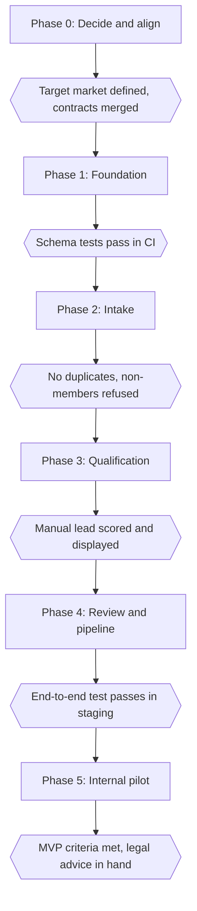

# 9. Team ownership and delivery plan

**Status:** Active. Recreated on 2 November 2026 after the earlier version was lost, so it is a new plan rather than a restored copy.

**Current state:** The repository holds documentation, workflow specifications, one prompt and one untested SQL migration. No application, n8n workflow or test exists yet.

This document says who owns what, what has been decided and in what order the MVP gets built. `docs/08-team-workflow.md` still covers general cadence and the definition of done.

## Ownership

Ownership means being accountable for a deliverable, not being limited to it. All three developers can work across the codebase and review each other's work.

| Person | Location | Primary ownership | Accountable for |
|---|---|---|---|
| Donnovan | Warsaw, Poland | Product application and integration | Next.js app, authentication flows, dashboard, overall integration |
| Jerome | North Carolina, USA | Platform foundation | Supabase schema, RLS, migrations, security, ingest API |
| Mako | Pretoria, South Africa | Discovery, AI and automation | Claude qualification, scoring, evaluation, outreach drafts, n8n, notifications |

### Working across time zones

Warsaw is 6 hours ahead of North Carolina all year. Pretoria is 1 hour ahead of Warsaw in the northern winter and level with it in the northern summer.

| North Carolina | Warsaw (winter) | Pretoria |
|---|---|---|
| 09:00 | 15:00 | 16:00 |
| 12:00 | 18:00 | 19:00 |

- Proposed shared window: 09:00 to 12:00 in North Carolina, for the weekly planning session and demo.
- Work asynchronously by default, so decisions and contract changes go in pull requests or this document, not only in calls.
- A PR should say what is needed and by when, so the next person can continue without waiting for a call.

## Decisions

| # | Topic | Decision | Status |
|---|---|---|---|
| 1 | Repository visibility | Public for now; review later | Agreed |
| 2 | Where the Claude call lives | One typed module in the Next.js app, triggered by n8n | Agreed |
| 3 | How n8n writes data | Through a signed internal API; n8n holds no Supabase secret | Agreed |
| 4 | First automated source | Manual entry and CSV come first; choose the connector after the permission review (M8) | Agreed; connector open |
| 5 | First segment and services | See "Target market" below | Agreed; "mid-sized" still to be defined |
| 6 | Definition of `qualified` | Score of 60 or higher with no disqualifier; calibrate on the evaluation set | Agreed |
| 7 | Legal entity and jurisdictions | Target countries are set. Public brand is Spiritus Agentic Solutions; confirm the registered entity and country of incorporation, then take legal advice | **Open: entity and advice needed** |
| 8 | Who may approve outreach | Everyone on the team | Agreed |
| 9 | Spending | No paid services for now; see "Working without paid services" | Agreed |
| 10 | Running SQL | Donnovan reviews and runs all SQL first | Agreed |

### Target market

- **Segment:** mid-sized professional services firms, including consultancies, accounting firms and business services companies.
- **Geography:** Zimbabwe and South Africa first, with Zambia and Botswana planned for later.
- **Priority services:** Agentic Workflows, Automation & Integration, and AI Knowledge Operations.
- **Value focus:** reducing repetitive administrative work, streamlining processes, connecting existing systems and improving access to business information.
- **Initial goal:** a focused internal tool that identifies relevant prospects, assesses their potential fit and prepares personalised outreach for human approval.
- **Long-term direction:** global. A country goes live only after its legal review and source permissions are recorded. The internal MVP still comes first.

### What decision 8 means

- Any workspace member can edit, approve or reject a draft.
- One person may edit and approve the same draft, so there is no second-person check.
- The database records who approved each draft, keeps the AI's original text and locks approved text.
- The `reviewer` role is no longer needed for the MVP. Remove it when the schema is corrected unless the team finds another use for it.
- Revisit this decision if anyone outside the core team joins the workspace.

### Working without paid services

| Service | Approach for now | When this changes |
|---|---|---|
| GitHub Actions | Runs the app checks for free on this public repository | If the repository goes private, check the free allowance |
| Supabase | Local development, then the Free plan with fake data | Pro is worth reviewing before the pilot, for daily backups and no pausing |
| Vercel | Run locally for now, because Hobby is limited to non-commercial personal use | A deployed internal pilot needs a decision on Pro or another host |
| Anthropic API | Build and test with fixtures | Live qualification (M3) needs API credit |
| n8n | Use the existing instance if it costs nothing extra | Confirm what it runs on in M4 |

## Permissions

| Capability | Owner, admin | Member | n8n and server |
|---|---|---|---|
| Read workspace data | Yes | Yes | Through the API |
| Add a manual lead, record notes and events | Yes | Yes | Ingest only |
| Edit, approve or reject a draft | Yes | Yes | Create pending drafts only |
| Write AI analyses | No | No | Yes |
| Change services, sources or members | Yes | No | No |
| Erase a lead | Yes | No | No |

## Architecture rules

- Every lead enters through one `ingestLead()` function, whether it comes from the form, a CSV or n8n.
- Every qualification runs through one `qualifyLead()` module. n8n triggers it and does not call Claude directly.
- The database acts as the work queue. n8n claims leads with a function using `for update skip locked`, and records attempts and the last error.
- Postgres enforces lead transitions, draft approval and the append-only audit trail, so these rules also bind the service role.
- No component can send a message to a prospect. Sending remains a manual step in the MVP.
- Build for more countries without building for all of them now: ISO country codes on leads and sources, UTC timestamps, explicit currency, and compliance rules that can vary by country. Translation and multi-region hosting wait until a market needs them.

## Shared contracts

Merge these as soon as the app scaffold (D1) lands, and before any work that depends on them. They live in `src/contracts/` as Zod schemas, apart from the state machine and database types.

| Contract | Defines | Owner | Consumers |
|---|---|---|---|
| Lead ingest envelope | Fields, dedupe keys, idempotency key, responses for created and duplicate | Jerome | Mako, Donnovan |
| Qualification output | Fields, criteria ranges, evidence shape, actions, disqualifiers, unknowns | Mako | Jerome, Donnovan |
| Lead and draft state machine | Allowed transitions, who may make them, status set by score | Jerome | All |
| Internal API authentication | HMAC format, timestamp window, one secret per direction | Jerome | Mako |
| Claim and retry | How n8n claims work, reports results and recovers failures | Jerome and Mako | Mako |
| Generated database types | One command, committed, and checked in CI | Donnovan | All |

## Delivery phases

Dates will be added once weekly hours are agreed. The phases are in dependency order, and each ends at a gate that can be tested.

| Phase | Outcome | Tasks | Gate |
|---|---|---|---|
| 0. Decide and align | Open decisions closed, app skeleton and CI in place, contracts agreed | S1, D1, S2, start M8 | Target market defined; contracts merged and reviewed by all three |
| 1. Foundation | Corrected schema, RLS tests, evaluation set and prompt | J1 to J5, M1, M2 | Schema tests pass in CI, then apply to the development Supabase project |
| 2. Intake | Team can sign in and add leads | J6, D2, D3, D4 | Replays create no duplicates; non-members are refused |
| 3. Qualification | First working flow | M3, D5 | A manual lead is scored and displayed with evidence; evaluation meets the agreed bar |
| 4. Review and pipeline | Drafts reviewed, pipeline tracked, alerts running | M4 to M7, D6, D7, J7, S4 | A test lead reaches an approved draft in staging; nothing can send without approval |
| 5. Internal pilot | SpiritusTec uses it on real work | M9, D8, S3 | `docs/03-mvp-roadmap.md` criteria met; legal advice received before real outreach |

## Backlog

### Shared

| ID | Task | Acceptance criteria | Depends on |
|---|---|---|---|
| S1 | Close decisions 5 and 7 | "Mid-sized" defined; registered entity and country of incorporation recorded in this document | None |
| S2 | Agree the shared contracts | Schemas merged and reviewed by all three | D1 |
| S3 | Obtain legal advice | Written answer on discovery, storage and first contact, summarised in `docs/06-integrations-and-compliance.md` | Decision 7 |
| S4 | End-to-end test | A test lead travels from entry to an approved draft in staging | J3, M6, D6 |

### Jerome

| ID | Task | Acceptance criteria | Depends on |
|---|---|---|---|
| J1 | Adopt Supabase CLI and move the migration | `supabase db reset` works from clean on all three machines | None |
| J2 | Correct the schema | Every item under "Schema corrections" is done and tested | J1 |
| J3 | Add the state machine and approval functions | Forged approval, edits after approval and illegal transitions are refused, including for the service role; every status change writes an audit row | J2 |
| J4 | RLS test suite in CI | Two workspaces and every role, covering every table and action | J2, D1 |
| J5 | Bootstrap and seed | One command creates the SpiritusTec workspace, three members, profile and confirmed catalogue | J2, decision 5 |
| J6 | Signed ingest API with `ingestLead()` | Bad or stale signature gets 401; replay returns the same lead ID; dedupe covers source ID, URL and hash | D1, S2 |
| J7 | Suppression and erasure | A suppressed identifier blocks drafting after the lead is erased and found again | J3 |

### Donnovan

| ID | Task | Acceptance criteria | Depends on |
|---|---|---|---|
| D1 | Scaffold Next.js, TypeScript and Tailwind, with CI | Lint, type check and tests run on each PR; Vercel previews are deferred | None |
| D2 | Authentication | Invite only; signed-out users are redirected; non-members are refused on the server | D1, J5 |
| D3 | Manual lead form and CSV import | Both call `ingestLead()`; a duplicate shows the existing lead; bad rows are reported by line | D2, J6 |
| D4 | Lead list | Filter by status, score, source and service; paginated | D2, S2 |
| D5 | Lead detail | Source text and link shown apart from AI interpretation; score breakdown, evidence quotes and unknowns all visible | D4, M3 |
| D6 | Draft review | Edit, approve and reject call the database functions; approved text is locked; approver is named | D5, J3 |
| D7 | Pipeline view | Moves use `transition_lead()`; illegal moves show a clear error; history is visible | D5, J3 |
| D8 | Settings and overview | Admins edit catalogue and sources; overview counts match the database | D7 |

### Mako

| ID | Task | Acceptance criteria | Depends on |
|---|---|---|---|
| M1 | Evaluation set | 40 to 50 labelled leads, team-written, with no real personal data, including injection attempts | Decision 5 |
| M2 | Schema, rubric and prompt v1 | Versioned prompt split into system and user messages; lead content cannot escape its wrapper | S2, M1 |
| M3 | `qualifyLead()` module | Invalid output is never stored; code calculates totals; evidence quotes are verified against the source; tokens logged; evaluation report in CI | M2, J2 |
| M4 | Secure n8n environment | Auth on, webhooks signed, secrets only in the credential store, exports contain no secrets | None |
| M5 | Qualification poller | Claims work safely; retries with backoff; stuck leads recover and alert after a set number of failures | M3, M4, J3 |
| M6 | Outreach prompt and generation | Only verified facts and approved positioning; suppressed leads skipped; unknown links flagged; no send path exists | M3, J7 |
| M7 | Telegram alerts | High-priority, review and failure alerts with no repeats; link and score only | M5 |
| M8 | Source permission review | Current terms and permitted API documented for each candidate in `docs/source-permissions.md` | None |
| M9 | First connector | Permission reference recorded; rate limited; replays create no duplicates | M8, J6, M4 |

## Schema corrections

These are done in `supabase/migrations/`, which replaces the original `001_initial_schema.sql`, and `supabase/tests/database/rules.test.sql` covers the main rules. Donnovan reviews and runs them first, and Jerome reviews the PR, before anything reaches a hosted project.

**Access and bootstrap**

- [x] Replace open workspace creation with a trusted seed, and turn off public signup.
- [x] Replace "any member can do anything" policies with the permissions table above.
- [x] Only owners manage owners, and the last owner cannot be removed.
- [x] Let members read the profiles of people in their workspaces.
- [x] Move helper functions out of the exposed schema, and revoke execution from `public` and `anon`.
- [x] Use `(select auth.uid())` and `to authenticated` in policies.

**Approval and audit**

- [x] Approve through a function that takes the approver from `auth.uid()`, and refuse any other route to `approved`.
- [x] Lock approved text; a change returns the draft to pending.
- [x] Enforce lead transitions with a trigger that writes `pipeline_events`.
- [x] Make `pipeline_events` and `contact_events` append-only, with the author set by the database.

**Integrity**

- [x] Remove the `where` clause from `leads_source_record_unique` so `on conflict` works. Null record IDs are still allowed.
- [x] Add `canonical_url`, and prevent duplicates for records without a source ID.
- [x] Use composite foreign keys so child records cannot point at another workspace's lead.
- [x] Require `permission_reference` before a source can be enabled.
- [x] Default new services to `developing` instead of `confirmed`.
- [x] Check the range of each score criterion, and let only the server write analyses.
- [x] Maintain `updated_at` with a trigger, and index `workspace_id` and `lead_id` foreign keys.

**Data protection**

- [x] Add a `suppression_list` with a hashed identifier that survives lead deletion.
- [x] Add an audited erase function for leads.
- [x] Make `workspaces.created_by` nullable with `on delete set null`, so user deletion is not blocked.
- [x] Add a retention date to leads.

**Missing fields**

- [x] `leads`: country or region, contact channel or identifier, `next_action_at`, qualification attempts and last error.
- [x] `lead_analyses`: confidence, buying intent, urgency, budget, requirements and token usage.
- [x] `outreach_drafts`: the AI's original text, source analysis, prompt version and rejection reason.
- [x] Service matches reference `services.id` instead of free text.
- [x] An ingestion idempotency record.

## Working agreement

- Use short-lived branches, keep `main` protected and require a review from another owner.
- Add a `CODEOWNERS` rule so changes to `src/contracts/` and `supabase/migrations/` need that review.
- Change the schema through migrations only, never by hand.
- Use fake data in the single development Supabase project until decision 7 is resolved.
- Keep secrets out of Git and out of n8n workflow exports.
- While the repository is public, keep pricing floors, real lead data and customer data out of it.

## First branches

1. `feat/app-scaffold` (Donnovan): D1, kept small so it merges quickly.
2. `feat/db-foundation` (Jerome): J1, J2 and J3, tested locally alongside D1.
3. `docs/contracts` (all three): merge the shared contracts as soon as D1 lands.
4. `feat/ai-qualification` (Mako): M1, M2 and M3, starting from fixtures. M8 can start now.

These meet at the first working flow: a manual lead that is stored, scored and displayed with evidence.

## Open items

- [ ] Decision 5: define "mid-sized" so the evaluation set and scoring can apply it consistently.
- [ ] Decision 7: confirm the registered legal entity and country of incorporation, then take advice covering Zimbabwe and South Africa, and how a team in Poland, South Africa and the USA affects which laws apply.
- [ ] Choose hosting regions for Supabase, n8n and Vercel, considering latency and data protection rules.
- [ ] Agree the weekly meeting time in the proposed shared window.
- [ ] Decide which company name outreach uses. The docs and prompt say SpiritusTec; the public brand is Spiritus Agentic Solutions.
- [ ] Decide how scoring treats a firm that fits the segment but shows no buying signal, because `docs/01-product-overview.md` requires evidence of a need.
- [ ] Decide how scoring treats requests for services outside the three priorities.
- [ ] Agree each person's weekly hours, then add dates to the phases.
- [ ] Confirm whether `001_initial_schema.sql` has been applied to the Supabase project.
- [ ] Confirm the service catalogue against <https://spiritustec.com/>.
- [ ] Update the repository structure in `README.md`, which lists `src/README.md` and stops at `docs/08`.
